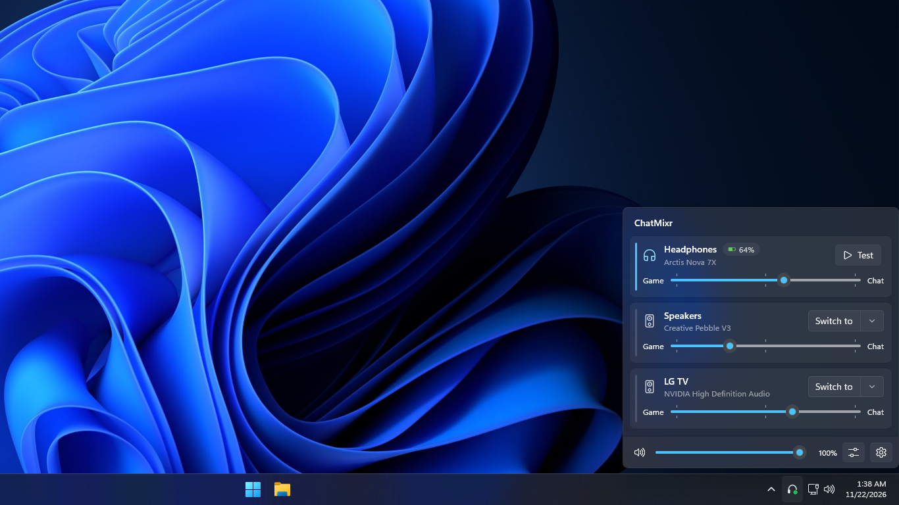
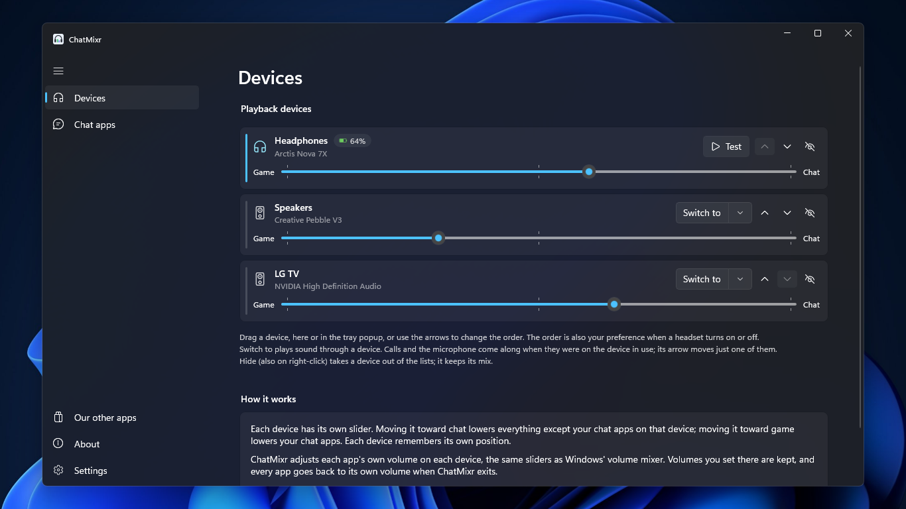
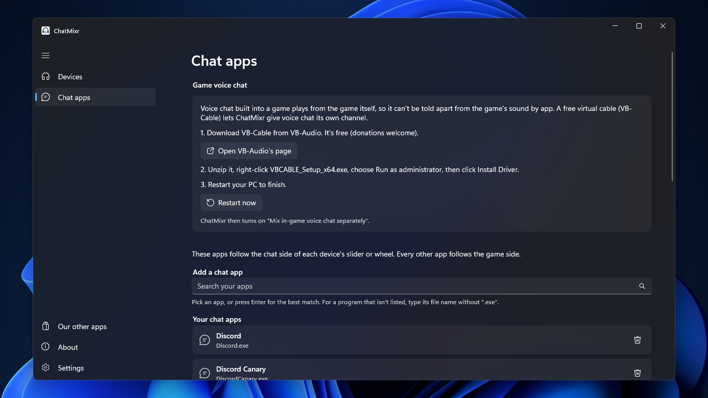

  

<h1 align="center">ChatMixr</h1>

  Balance game and chat audio on any headset, with a slider or your Arctis ChatMix wheel, without SteelSeries GG.

  

  
  &nbsp;
  
  &nbsp;
  

For anyone whose voice chat and game sound fight over the same headphones. Windows only offers a volume slider per app; ChatMixr gives each playback device one control that balances them. Turn toward chat and everything else gets quieter; turn toward game and your chat apps do. A SteelSeries Arctis Nova 7 headset's ChatMix wheel works too, without SteelSeries GG, on several headsets at once.

## Features

- **A slider for every device:** the tray popup lists your headsets, speakers and TVs, each with its own remembered balance, plus the volume of the one in use and an order you choose by dragging.
- **Arctis ChatMix wheels, without GG:** each connected Arctis Nova 7 receiver's wheel controls its own headset, so a desk headset and a couch headset both work at once. Battery and power show on each headset's card.
- **Chat against everything else:** Discord, Teams, Zoom, Slack, TeamSpeak, Mumble and other common chat apps are listed to start with, and you can add or remove any program.
- **In-game voice chat:** voice chat built into a game can have its own channel too. ChatMixr walks you through installing the free VB-Cable, then mixes it separately from the game's sound.
- **Switch devices the way you use them:** Switch to a headset and its microphone comes along, even after speakers or a TV; a separate microphone stays put. Calls follow when they were on the device you leave. Turn a headset, TV or speaker on or off and ChatMixr can switch for you.
- **Shortcuts and a popup:** optional keyboard shortcuts move the mix from any app, and a popup like Windows' volume popup shows the balance when a shortcut or wheel moves it.
- **In Xbox Game Bar:** press Win+G for a widget that moves the mix, switches devices and turns in-game voice chat on or off without leaving your game.
- **Hear it work:** Test plays a game sound and a chat sound together until you stop it, so you can move the slider or wheel and hear the balance change.
- **Your volumes stay yours:** ChatMixr scales each app's own volume, the same sliders as Windows' volume mixer. Changes you make there are kept, and every app goes back to its own volume when ChatMixr exits or Windows shuts down.
- **Fits in:** follows Windows' light or dark theme and language, and can start when you sign in.

## Get it

Get ChatMixr from the **[Microsoft Store](https://apps.microsoft.com/detail/9N3F55DFWLQP)**. It installs and stays up to date automatically. To build it yourself instead, follow the [development guide](docs/development.md).

ChatMixr collects no telemetry or crash reports.

### Requirements

- Windows 10 (22H2) or Windows 11, on x64 or ARM64.
- Any playback device for the sliders. For a wheel: a SteelSeries Arctis Nova 7 family headset and its receiver (tested on the Nova 7X and Nova 7X Gen 2).
- For in-game voice chat: [VB-Cable](https://vb-audio.com/Cable/), free from VB-Audio.

## How it works

- ChatMixr mixes by app. For chat in a browser tab, use the service's desktop app.
- With an Arctis headset, turn Sonar off in SteelSeries GG (or exit GG). ChatMixr tells you if it is on.
- On Windows 10, the tray icon may start among the hidden icons (the arrow next to the clock). Drag it onto the taskbar to keep it in view.

## Languages

ChatMixr is available in English (United States and Canada), Spanish, French (France and Canada), German, Simplified Chinese, Brazilian Portuguese and Japanese. It follows Windows' language unless you pick one in Settings.

## Developers

- [Development guide](docs/development.md): building, checking, manual checks, and where the app stores data.
- [Agent instructions](AGENTS.md): the code map, the rules a change can break, and conventions.
- [Architecture](ARCHITECTURE.md): how mixing, devices, headsets and in-game voice chat work, and the [receiver protocol](docs/protocol.md).
- [UI conventions](.agents/guides/ui-conventions.md): how the windows, popups and cards are built.

## License

Copyright (c) 2026 Dynamic Solutions. Licensed under the [PolyForm Noncommercial License 1.0.0](LICENSE), free for personal and other noncommercial use. ChatMixr is not made by or affiliated with SteelSeries.
